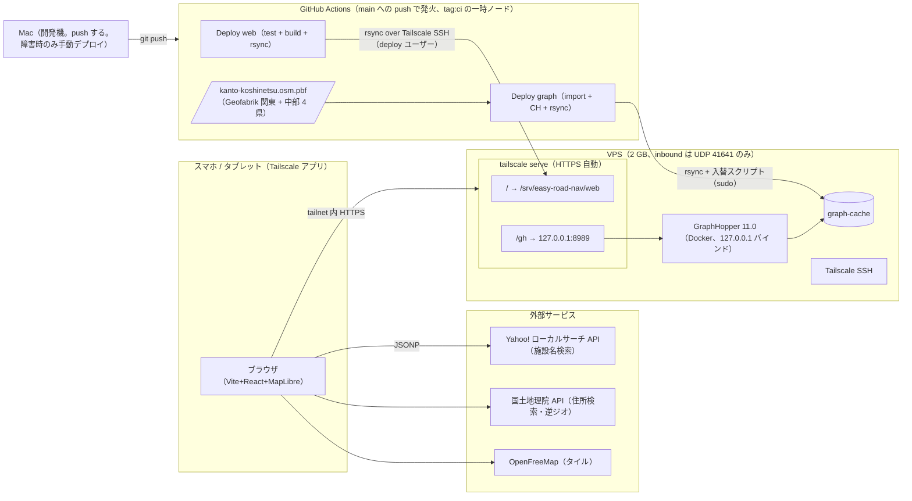

# 基盤

「何を・なぜ」を書く。手順は [runbook.md](../runbook.md)。

## 構成

- フロント: Vite + React + TypeScript + MapLibre GL JS。静的ファイル。構成は [frontend.md](frontend.md)
- バックエンド: GraphHopper 11.0（Docker、`israelhikingmap/graphhopper:11.0`）。フロントからは同一ホスト名の `/gh/*` 経由で呼ぶ
- 外部: OpenFreeMap（タイル）、国土地理院 API（住所検索・逆ジオ）、Yahoo! ローカルサーチ API（施設名検索。JSONP、appid はビルド時埋め込み）
- 公開・認証: Tailscale。VPS を tailnet に置き、共有先の端末へノード共有。公開 URL・ドメイン・ID/PW なし

## 構成図

- 到達経路は Tailscale のみ。認証は Tailscale アカウント（ノード共有の受諾）
- VPS 上の設定ファイルは compose 1 つ。リバースプロキシ・`.env` なし
- VPS への書き込みは専用ユーザー `deploy` のみ。詳細は「デプロイ」

## 外部サービス

このアプリが使う外部サービスの一覧。帰属表示は「ライセンス・帰属」、料金は「費用」にある。

アプリ実行中（スマホのブラウザから直接呼ぶ。VPS は経由しない）:

- OpenFreeMap（`tiles.openfreemap.org`）: 地図のスタイル・ベクトルタイル・フォント・アイコン。アプリはスタイル URL（`src/map/mapLayers.ts` の `STYLE`）を MapLibre に渡すだけで、残りは MapLibre がスタイルの記述に従って取得する。詳細は [map-display.md](map-display.md)「タイル」
- 国土地理院 住所検索 API（`msearch.gsi.go.jp`）: 住所から座標を引く。`src/search/gsi.ts`。詳細は [search.md](search.md)
- 国土地理院 逆ジオ API（`mreversegeocoder.gsi.go.jp`）: 座標から市区町村 + 町字を引く。`src/search/gsi.ts`
- Yahoo! ローカルサーチ API（`map.yahooapis.jp`）: 施設名から座標を引く。CORS ヘッダを返さないので JSONP で呼ぶ。Client ID は `.env.local` の `VITE_YAHOO_APPID` をビルド時に埋め込む。`src/search/yahoo.ts`。採用経緯は [ADR-0003](../adr/0003-poi-geocoder-yahoo.md)、ID 発行は [runbook.md](../runbook.md) 6 章

データ作成（GitHub Actions のランナーから。Deploy graph のたび。Mac でも回せる）:

- Geofabrik（`download.geofabrik.de`）: 関東・中部の OSM pbf。`make pbf`（`scripts/build-pbf.sh`）が取得する
- Nominatim（`nominatim.openstreetmap.org`）: 県境 GeoJSON。県を足すときだけ手で取得し、`scripts/regions/` に置く。手順は [runbook.md](../runbook.md) 5 章

配信・運用:

- Tailscale: 公開（`tailscale serve` と HTTPS 証明書）、認証（ノード共有）、SSH、CI ランナーの一時参加（署名済み auth key）。端末どうしが直接つながらないときは Tailscale の DERP 中継を通る。VPS への導入は `scripts/vps-setup.sh`。詳細は「公開」
- GitHub Actions: main への push で web と graph-cache を VPS へ反映する。public リポジトリなので無料。詳細は「デプロイ」
- Docker Hub: GraphHopper のイメージ `israelhikingmap/graphhopper:11.0`。ランナー・Mac・VPS が `compose.yml` に従って取得する

## GraphHopper 設定

- compose は 1 ファイル（`compose.yml`）をランナー・Mac・VPS で共用。イメージ tag は共通設定 `x-common` の 1 箇所に固定、`latest` は使わない
- サービスで役割を分ける
  - `import`: ランナー（Deploy graph）と、確認したいときの Mac。`--import`。ヒープ 4 GB。`profiles: [import]` で `up` / `down` の対象外にし、明示実行のみ
  - `serve`: Mac 開発・VPS 共通。`-Xmx1g`、`mem_limit: 1.5g`
- `ports` は `127.0.0.1:8989:8989` 必須。`8989:8989` と書くと Docker が iptables を貫通して全開になる
- `graph.dataaccess.default_type`: `serve` は `MMAP_STORE`（graph-cache を mmap、ヒープ外・OS ページキャッシュに乗る）。`import` は `RAM_STORE`（既定、速い）。両者は同じ graph-cache を読める
- ターンコスト有効（[routing.md](routing.md)）→ edge-based CH。graph-cache は node-based の 1.5〜2 倍、インポート時間も増える
- VPS は配信専用。インポート・CH 再計算はランナー（障害時は Mac）で行い、graph-cache を転送する
- graph-cache 互換条件: 同一イメージ tag + 同一 `config.yml`（プロファイル・custom model・CH 設定）。不一致だと GraphHopper がロードを拒否する。ランナーは import と転送を同じコミットから行うので揃う。アーキテクチャ差（Mac arm64 → VPS amd64）は問題ない（on-disk 形式は little-endian 固定）
- `config.yml` の要点（GraphHopper 11.0 で確認済み）: pbf は `datareader.file`、`import.osm.ignored_highways` は必須キー（未指定で起動失敗）、`custom_model_files` は複数指定でき順にマージされる（共通部 + 差分の分割が可能）、`graph.urban_density.threads` で市街地判定を有効化（速度係数が参照。取り込み時間が増える）
- `/gh` prefix は開発（Vite `server.proxy` の `rewrite`）・本番（`tailscale serve --set-path`）とも剥がして転送する。フロントのベース URL は環境問わず `/gh` 固定。`serve` の prefix 剥がしは未文書化の挙動（実装で確認済み）

## ファイル配置

Mac（リポジトリ）:

- `compose.yml`
- `graphhopper/config.yml`、`graphhopper/custom_models/*.json` — git 管理
- `data/*.osm.pbf`、`data/graph-cache/` — gitignore。compose から相対パスで mount
- `.env.local` — `VITE_YAHOO_APPID`（Yahoo! ローカルサーチの Client ID）。gitignore（`*.local`）。`vite build` と Vite dev が読み、ビルド成果物に埋め込まれる。VPS には置かない。CI では同名の環境変数（Environment secret）で渡す
- `.github/workflows/deploy-web.yml`、`deploy-graph.yml` — デプロイの workflow
- `scripts/swap-web.sh`、`scripts/swap-graph.sh`、`scripts/vps-ci-user.sh` — VPS に置く入替スクリプト（web・graph）と、その設置スクリプト
- `src/` 以下は [frontend.md](frontend.md)

GitHub（Environment `production`、デプロイ元は main のみ）: `TAILSCALE_AUTHKEY` `VPS_HOST` `VITE_YAHOO_APPID`。リポジトリには書かない

VPS:

- `/srv/easy-road-nav/web` — 静的ファイル（`tailscale serve` の `/`）。root 所有。`tailscale serve` は root で動き、ツリー外を指す symlink もたどるので、`deploy` が書ける場所を直接配信しない
- `/srv/easy-road-nav/web.new/` — web の rsync の受け口。`deploy` 所有
- `/srv/easy-road-nav/data/graph-cache`（compose の `./data` mount に合わせる。入替中は `graph-cache.new` `graph-cache.old` が隣に出る）。`data/` は `deploy` 所有
- `/srv/easy-road-nav/graphhopper.new/` — graph の rsync の受け口。`deploy` 所有
- `/srv/easy-road-nav/graphhopper/`、`/srv/easy-road-nav/compose.yml`、`/srv/easy-road-nav` 自体 — root 所有。`compose.yml` は入替スクリプトが main から取る
- `/usr/local/sbin/easy-road-nav-swap-web`、`/usr/local/sbin/easy-road-nav-swap-graph`、`/etc/sudoers.d/easy-road-nav-swap`、`/var/log/easy-road-nav-swap-graph.log`
- VPS のホスト名は `VPS_HOST`（`deploy@host.tailnet.ts.net`）で渡す。リポジトリに書かない
- CI と手動デプロイは `deploy` ユーザー（sudo の一般権限なし・docker グループなし）。初期構築・調査は `ubuntu`（sudo 付き）。root ログインしない

## 開発環境

- GraphHopper: Mac ローカル Docker（compose `serve`）。関東甲信越データでも Docker Desktop 既定メモリ（8 GB）で足りる。インポートのヒープは 4 GB 固定（6 GB にすると同居コンテナ次第で VM ごと OOM。2026-10-20 に exit 137 を確認）
- フロント: Vite を Mac でネイティブ起動。`server.proxy` で `/gh` → `localhost:8989`（`rewrite` で prefix 除去）。Docker 化しない（bind mount 経由の HMR・ファイル監視が遅く、`node_modules` の扱いも面倒）
- スマホ実機検証: Geolocation は HTTPS 必須なので Mac を tailnet に入れ `tailscale serve --bg 5173` で Vite dev を公開（詳細は [frontend.md](frontend.md)）
- データ: `kanto-koshinetsu.osm.pbf`（約 770 MB）。対象は関東 1 都 6 県 + 山梨・長野・新潟・静岡（ファイル名は歴史的経緯でそのまま）。Geofabrik に県単位の pbf はないので、`make pbf`（`scripts/build-pbf.sh`）が関東 496 MB に、中部 489 MB から県境ポリゴンで切り出した山梨 22 MB・長野 70 MB・新潟 60 MB・静岡を `osmium merge` する。県境は `scripts/regions/*.geojson`（Nominatim の行政境界、簡略化済み）
- インポート目安: ヒープ 4 GB、約 22 分（関東甲信越、使用ヒープ最大 2.4 GB）。CH 2 プロファイル込み

## 公開

- VPS: VPS 2 GB（日額課金、月上限 ¥770）。`MMAP_STORE` のため graph-cache 本体はヒープ外で、ページキャッシュに乗る分だけ VPS の空きメモリが効く。ヒープは CH 探索・応答生成用で `-Xmx1g` を上限に置き、実測で下げる（GraphHopper 公式の「graph-cache サイズ − geometry」は RAM_STORE 用の目安で、ここでは使わない）
- ヒープ実測: VPS 契約前に Mac で `serve` を `-Xmx1g` + `mem_limit: 1.5g` で起動し、数十リクエストで OOM なしを確認。通れば 2 GB、落ちれば 4 GB（¥1,760）。VPS には swap 2 GB を置く（OOM kill 保険）
  - 実測（2026-10-09、`scripts/heap-check.sh` 50 周 = 600 リクエスト、関東 graph-cache 746 MB）: 1.17 GiB / 1.5 GiB、OOM なし、全件 200。→ 2 GB で決定
  - 実測（2026-10-20、関東甲信越 graph-cache 832 MB、`scripts/heap-check.sh` 12 ペア × 50 周 = 1,200 リクエスト、東京→新潟 316 km 含む）: 1.18 GiB / 1.5 GiB、OOM なし、全件 200。ヒープは `-Xms1g` 固定なので、グラフが増えて伸びるのは mmap ページ分だけ
  - 実測（2026-10-22、関東甲信越 + 静岡 graph-cache 919 MB、15 ペア × 50 周 = 1,500 リクエスト）: 1.30 GiB / 1.5 GiB（86 %）、OOM なし、全件 200
- 公開: `tailscale serve --bg`。`/` → 静的ディレクトリ、`/gh` → `http://127.0.0.1:8989`（prefix を剥がして転送）。HTTPS は `<host>.<tailnet>.ts.net` の証明書を自動発行・更新。ドメイン不要
- 認証: Tailscale。VPS ノードを共有先の Tailscale アカウントへ共有（無料枠 6 ユーザーの枠外、見えるのは VPS のみ）。追加・削除は管理画面
- ACL: 共有先（`autogroup:shared`）から VPS へは tcp:443 のみ。SSH は自分（check）と CI ランナー `tag:ci`（accept、`deploy` ユーザーのみ、届く先は VPS の tcp:22 のみ）。共有先に見えるのは HTTPS のみ
- Tailnet Lock: 有効。新しいノードは signing node（Mac・iPhone・VPS）の署名がないと他ノードと通信できない。Tailscale のアカウントやコントロールプレーンが破られても、tailnet にノードを足すだけでは VPS に届かない
- CI ランナーの参加: 署名済み（pre-signed）auth key（reusable・ephemeral・`tag:ci`）。Tailnet Lock 下では OAuth クライアントが使えない。OAuth はランナー上で auth key を発行するので事前に署名できず、参加したノードが locked out になる（2026-10-31 の初回 Deploy web が `Connection timed out` で落ちた原因）。auth key は最長 90 日で失効するので、90 日ごとに Mac で `tailscale lock sign` し直して差し替える（[runbook](../runbook.md) 2 章、[ci-authkey-rotation.md](../ci-authkey-rotation.md)）。漏れても入れるのは `tag:ci` のノードだけ
- 共有先の端末からは FQDN `<host>.<tailnet>.ts.net` でのみ到達できる（短縮ホスト名は不可）
- ネットワーク: inbound は UDP 41641（Tailscale 直接接続用）のみ許可、他は全閉。閉じると DERP 中継に落ちてレイテンシが増える
- SSH: Tailscale SSH（`tailscale up --ssh`）。鍵管理なし。初期セットアップ後に 22 番を閉じる
- `tailscale serve` の制約: gzip 圧縮・ヘッダ制御・SPA fallback なし。URL 共有はクエリ形式なので fallback 不要。圧縮が要るなら Caddy を compose に 1 サービス追加して `serve` の後段に置く

## デプロイ

- main への push で GitHub Actions が反映する。Mac から `npm run deploy` / `npm run deploy:graph` を打つのは Actions が使えないときだけ
- 頻度が違うので web と graph は別 workflow・別コマンド。`concurrency` のグループも別（`deploy-web` / `deploy-graph`）。GitHub の待ち行列は 1 グループに 1 件しか持てず、同じグループだと web の push で待っていた graph が取り消されるため。両方とも `cancel-in-progress: false`（graph の入替を途中で切らない）。web は `web.new/` と `web/`、graph は `data/` と `graphhopper*/` と `compose.yml` にしか書かないので同時に動いてもぶつからない
- Deploy web: main への push。`docs/**` と `**.md` だけなら動かない。`npm ci` → `npm test` → `npm run deploy`（`vite build` → `scripts/deploy-web.sh`: `rsync --delete` で `web.new/` へ → VPS の入替スクリプトを `sudo -n` で呼ぶ）。テストか型検査が落ちたら転送しない。既存の Test workflow と重なるが、`workflow_run` で待ち合わせるより 1 ファイルで完結するほうが追いやすい
- Deploy graph: `graphhopper/**`・`compose.yml`・`scripts/build-pbf.sh`・`scripts/regions/**`・`scripts/deploy-graph.sh` を含む push、または `workflow_dispatch`（OSM データだけ新しくするとき。空コミットを避ける）。ランナー（4 vCPU・16 GB）で `make pbf` → `make import` → `scripts/deploy-graph.sh`。pbf は毎回最新を取るので、custom model の調整値を変えて実走で比べるとデータ側の差も混ざる（v1 では許容。pbf のキャッシュは入れない）。`schedule` は付けない。ルートの変化に気づかないまま案内が変わるため
- web と graph のどちらが先に終わるかは決まらない。フロントが呼ぶプロファイルを足す push では、serve にまだないプロファイルをフロントが呼ぶ時間ができる。workflow で待ち合わせず、push の順番で避ける（足すときは graph を先に、消すときはフロントを先に）
- web の入替スクリプト（`scripts/swap-web.sh` → VPS の `/usr/local/sbin/easy-road-nav-swap-web`、root で動く）: `web.new/` を root 所有の `web.next/` へコピーしてから symlink 等を拒否 → `web/` と入れ替え。`tailscale serve` は root で動き、Go の `http.Dir` はツリー外を指す symlink もたどるので、`deploy` が書ける場所をそのまま配信すると root しか読めないファイルを HTTPS 越しに読ませられる。graph と同じ形で塞ぐ。数十 ms の `mv` なので systemd 一時ユニットは使わない
- `deploy-graph.sh`: graph-cache を `data/graph-cache.new/`、`graphhopper/` を `graphhopper.new/` へ rsync し、VPS の入替スクリプトを `sudo -n` で呼ぶ。`compose.yml` は送らない
- 入替スクリプト（`scripts/swap-graph.sh` → VPS の `/usr/local/sbin/easy-road-nav-swap-graph`、root で動く）: systemd の一時ユニットとして自分を動かし直す（ssh が切れても最後まで走る。`timeout-minutes` 超過・手動 Cancel・Tailscale 切断で `down` と `up` の間で止まらない。ユニット名固定で同時実行もしない）→ `graphhopper.new/` を root 所有の場所へコピーしてから symlink 等を拒否（bind mount 元の symlink はホスト側で root としてたどられる。検査後に差し替えられないようコピーが先）→ main の先頭コミットの `compose.yml` を取得（`deploy` が書き換えられると root で任意のコンテナを起動できる。`main` 名で取ると CDN キャッシュで古いことがあるのでコミット指定）→ `docker compose down`（終了後にプロジェクトのコンテナが残っていれば中止。compose ファイル上で `profiles` 付き等の対象外サービスは down が無言で飛ばし、旧プロセスが旧 graph-cache を掴んだまま入替だけ進んでしまう）→ `compose.yml`・`graphhopper/`・graph-cache を入替 → `up -d serve` → `/info` を最大 60 秒確認。返らなければ 3 つとも戻して `up`（graph-cache だけ戻すと新 `compose.yml` のまま旧 graph-cache を起動することになり、tag を変えた push では切り戻しも失敗する）。稼働中の graph-cache への上書きは不可（mmap 中）。停止は数十秒、許容する
- `compose.yml` の取得元が main の先頭なので、ランナーが checkout したコミットとずれることがある（graph の job 中に別の push で main が進んだ場合）。その push で起きた次の実行が `concurrency` で順番を待っており、最新に揃え直す。ずれが image tag の変更なら入替は失敗して旧状態のまま動き続け、次の実行で揃う
- `deploy` ユーザー: sudo の一般権限なし・docker グループなし（docker グループは `docker run -v /:/host` でホスト全体を読み書きできるので root と変わらない）。書き込めるのは `web.new/` `data/` `graphhopper.new/` だけ。sudoers では 2 つの入替スクリプトの引数なし実行だけを許す。root が触るツリー（`web/` `graphhopper/`）は入替スクリプトがコピーしてから symlink を拒否するので、Secrets が漏れても被害は「web と graph-cache を差し替えられる」まで。`ubuntu`（sudo 付き）で CI を入れると、同じ VPS に載せる別アプリ（[vps-shared.md](../vps-shared.md)）まで巻き込む
- workflow の `permissions` は `contents: read` だけ。fork からの pull request には secrets が渡らず、発火条件も main への push だけ
- 手で残す作業: VPS 初期構築と Tailscale 管理画面、Yahoo! appid の発行と Secrets 登録、地域追加時の `make heap-check`（VPS プランを決める材料）、障害時の手動デプロイ
- 未決: ランナーでのインポート時間。初回の実行で測って `timeout-minutes`（90）を見直す

## 運用

- `restart: unless-stopped`。`tailscale serve --bg` は tailscaled が永続化し再起動後も復帰する
- OS 自動更新: `unattended-upgrades` + 自動再起動（04:00 JST）。Tailscale は `tailscale set --auto-update`
- バックアップ不要。VPS に固有状態を持たせない（graph-cache・静的ファイル・設定はすべてリポジトリから再生成・再転送できる）。例外は `tailscale serve` の設定・`deploy` ユーザー・入替スクリプトで、runbook 1 章のスクリプトで再現する
- 監視なし

## 見送った案

- 公開: Cloudflare Tunnel + Caddy basic_auth（ドメイン・cloudflared・Caddyfile・`.env` が要る。共有先のみなら Tailscale で全部消える）、80/443 直接開放（VPS 露出）
- ホスティング: 自宅 Mac（起動中のみ）、自宅ミニ PC（初期費用 2〜3 万、VPS ¥770 で足りる）、Hetzner（2026 年値上げ・安価プラン在庫切れ・SG は割高）、Oracle Always Free（2026/6 に 12 GB へ半減、容量確保困難）
- データ: 日本全国（RAM 8 GB 必要で月額 ¥3,410。県境越えは v1 で許容）
- 配信: Caddy 維持（圧縮・ヘッダ制御あり。`serve` → Caddy の直列 2 段で部品増。必要時に追加）
- 認証: Cloudflare Access OTP（スマホで再入力が手間）、Authelia（ログイン画面不要）
- デプロイ: GitHub Actions + self-hosted runner（常駐ランナーの面倒を見ることになる。ephemeral ノードで足りた）、Tailscale の OAuth クライアントでランナーを参加させる（期限切れがなく auth key の差し替えが要らないので当初採用したが、Tailnet Lock と両立しない。署名済み auth key に戻し、90 日ごとの差し替えを受け入れた）、Tailnet Lock を切って OAuth を続ける（アカウント侵害時にノードを足されない防御を失う。差し替えは 90 日に 1 回 5 分なので Lock を残した）。以前は「auth key を Actions に置く必要」を理由に Actions 自体を見送っていたが、権限を `tag:ci` と `deploy` に絞れば置いてよいと判断を改めた、`schedule` による定期データ更新（ルートの変化に気づけない）、pbf のランナーキャッシュ（v1 では不要）
- VPS 上での CH 再計算（2 GB で足りるか未検証、配信停止が伸びる。ランナーで回して転送する方が単純）
- Mac/VPS で compose を分ける（tag を手で揃える運用になる。`profiles` で 1 ファイルにした）

## データ更新

- 手で起こす・不定期。Deploy graph を `workflow_dispatch` で実行すると、ランナーが pbf 再取得 → インポート・CH 再計算 → 入替まで行う
- custom model 変更（ペナルティ等）は push で同じ流れ。pbf も毎回取り直す
- GraphHopper バージョン更新: tag を上げて push。graph-cache はバージョン間で互換しない前提
- 地域追加: `scripts/regions/` に県境 GeoJSON を足し、`build-pbf.sh` の取得リージョンと結合対象に加える → push。全国化: `japan-latest.osm.pbf`（2.4 GB）に差し替え、RAM 8 GB → VPS プラン変更（8 GB ¥3,410）
- 手順詳細は [runbook.md](../runbook.md)

## テスト

- 純ロジック（React を import しないファイルの純関数と store）のみ Vitest。UI・GraphHopper 呼び出しは手動確認。詳細は [frontend.md](frontend.md)

## ライセンス・帰属

- OSM データ: ODbL。帰属表示必須
- OpenFreeMap: 帰属表示必須
- 国土地理院 API: 利用規約に従い出典明記
- Yahoo! ローカルサーチ API: クレジット表示ガイドラインに従い「Webサービス by Yahoo! JAPAN」を `https://developer.yahoo.co.jp/sitemap/` にリンクして表示。無料条件（一般公開の無償サービス）との関係は [ADR-0003](../adr/0003-poi-geocoder-yahoo.md)

## 費用（月額、2026-09 時点）

- VPS 2 GB: ¥770（日額 ¥28 上限。年一括なら ¥715 相当）
- Tailscale Personal: ¥0（6 ユーザー・端末無制限、2026-04 改定。ノード共有・Serve・SSH 込み）
- OpenFreeMap / 国土地理院 API / Yahoo! ローカルサーチ API: ¥0
- GitHub Actions: ¥0（public リポジトリ。`ubuntu-latest` 4 vCPU・16 GB）
- ドメイン・Cloudflare: 不使用
- 合計: ¥770
