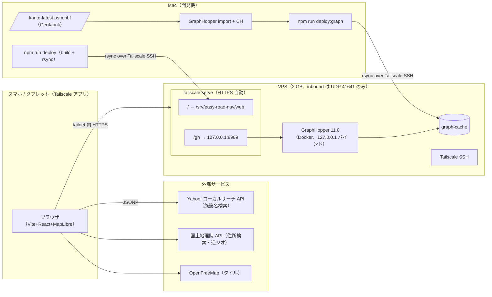

# 基盤

「何を・なぜ」を書く。手順は [runbook.md](../runbook.md)。

## 構成

- フロント: Vite + React + TypeScript + MapLibre GL JS。静的ファイル。構成は [frontend.md](frontend.md)
- バックエンド: GraphHopper 11.0（Docker、`israelhikingmap/graphhopper:11.0`）。フロントからは同一ホスト名の `/gh/*` 経由で呼ぶ
- 外部: OpenFreeMap（タイル）、国土地理院 API（住所検索・逆ジオ）、Yahoo! ローカルサーチ API（施設名検索。JSONP、appid はビルド時埋め込み）
- 公開・認証: Tailscale。VPS を tailnet に置き、共有先の端末へノード共有。公開 URL・ドメイン・ID/PW なし

## 構成図

- 到達経路は Tailscale のみ。認証は Tailscale アカウント（ノード共有の受諾）
- VPS 上の設定ファイルは compose 1 つ。リバースプロキシ・`.env` なし

## GraphHopper 設定

- compose は 1 ファイル（`compose.yml`）を Mac と VPS で共用。イメージ tag は YAML anchor で 1 箇所に固定、`latest` は使わない
- `profiles` で役割を分ける
  - `import`: Mac 専用。`--import`。ヒープ 4 GB
  - `serve`: Mac 開発・VPS 共通。`-Xmx1g`、`mem_limit: 1.5g`
- `ports` は `127.0.0.1:8989:8989` 必須。`8989:8989` と書くと Docker が iptables を貫通して全開になる
- `graph.dataaccess.default_type`: `serve` は `MMAP_STORE`（graph-cache を mmap、ヒープ外・OS ページキャッシュに乗る）。`import` は `RAM_STORE`（既定、速い）。両者は同じ graph-cache を読める
- ターンコスト有効（[routing.md](routing.md)）→ edge-based CH。graph-cache は node-based の 1.5〜2 倍、インポート時間も増える
- VPS は配信専用。インポート・CH 再計算は常に Mac で行い、graph-cache を転送する
- graph-cache 互換条件: 同一イメージ tag + 同一 `config.yml`（プロファイル・custom model・CH 設定）。不一致だと GraphHopper がロードを拒否する。アーキテクチャ差（Mac arm64 → VPS amd64）は問題ない（on-disk 形式は little-endian 固定）
- `config.yml` の要点（GraphHopper 11.0 で確認済み）: pbf は `datareader.file`、`import.osm.ignored_highways` は必須キー（未指定で起動失敗）、`custom_model_files` は複数指定でき順にマージされる（共通部 + 差分の分割が可能）
- `/gh` prefix は開発（Vite `server.proxy` の `rewrite`）・本番（`tailscale serve --set-path`）とも剥がして転送する。フロントのベース URL は環境問わず `/gh` 固定。`serve` の prefix 剥がしは未文書化の挙動（実装で確認済み）

## ファイル配置

Mac（リポジトリ）:

- `compose.yml`
- `graphhopper/config.yml`、`graphhopper/custom_models/*.json` — git 管理
- `data/*.osm.pbf`、`data/graph-cache/` — gitignore。compose から相対パスで mount
- `.env.local` — `VITE_YAHOO_APPID`（Yahoo! ローカルサーチの Client ID）。gitignore（`*.local`）。`vite build` と Vite dev が読み、ビルド成果物に埋め込まれる。VPS には置かない
- `src/` 以下は [frontend.md](frontend.md)

VPS:

- `/srv/easy-road-nav/web` — 静的ファイル（`tailscale serve` の `/`）
- `/srv/easy-road-nav/data/graph-cache`（compose の `./data` mount に合わせる。入替中は `graph-cache.new` `graph-cache.old` が隣に出る）
- `/srv/easy-road-nav/graphhopper/`、`/srv/easy-road-nav/compose.yml`
- VPS のホスト名は Mac 側の環境変数 `VPS_HOST`（`user@host.tailnet.ts.net`）で渡す。リポジトリに書かない
- 実行ユーザーは Tailscale SSH でログインする一般ユーザー（docker グループ）。root 運用しない

## 開発環境

- GraphHopper: Mac ローカル Docker（compose `serve`）。関東データなら Docker Desktop 既定メモリ（8 GB）で足りる
- フロント: Vite を Mac でネイティブ起動。`server.proxy` で `/gh` → `localhost:8989`（`rewrite` で prefix 除去）。Docker 化しない（bind mount 経由の HMR・ファイル監視が遅く、`node_modules` の扱いも面倒）
- スマホ実機検証: Geolocation は HTTPS 必須なので Mac を tailnet に入れ `tailscale serve --bg 5173` で Vite dev を公開（詳細は [frontend.md](frontend.md)）
- データ: `kanto-latest.osm.pbf`（Geofabrik、約 500 MB）。v1 は関東のみ。他地域は Geofabrik のサブリージョンを `osmium merge` で追加
- インポート目安: RAM 4 GB 程度、十数分。CH 2 プロファイル込み

## 公開

- VPS: VPS 2 GB（日額課金、月上限 ¥770）。`MMAP_STORE` のため graph-cache 本体はヒープ外で、ページキャッシュに乗る分だけ VPS の空きメモリが効く。ヒープは CH 探索・応答生成用で `-Xmx1g` を上限に置き、実測で下げる（GraphHopper 公式の「graph-cache サイズ − geometry」は RAM_STORE 用の目安で、ここでは使わない）
- ヒープ実測: VPS 契約前に Mac で `serve` を `-Xmx1g` + `mem_limit: 1.5g` で起動し、数十リクエストで OOM なしを確認。通れば 2 GB、落ちれば 4 GB（¥1,760）。VPS には swap 2 GB を置く（OOM kill 保険）
  - 実測（2026-10-09、`scripts/heap-check.sh` 50 周 = 600 リクエスト、関東 graph-cache 746 MB）: 1.17 GiB / 1.5 GiB、OOM なし、全件 200。→ 2 GB で決定
- 公開: `tailscale serve --bg`。`/` → 静的ディレクトリ、`/gh` → `http://127.0.0.1:8989`（prefix を剥がして転送）。HTTPS は `<host>.<tailnet>.ts.net` の証明書を自動発行・更新。ドメイン不要
- 認証: Tailscale。VPS ノードを共有先の Tailscale アカウントへ共有（無料枠 6 ユーザーの枠外、見えるのは VPS のみ）。追加・削除は管理画面
- ACL: 共有先（`autogroup:shared`）から VPS へは tcp:443 のみ。SSH は自分だけ。共有先に見えるのは HTTPS のみ
- 共有先の端末からは FQDN `<host>.<tailnet>.ts.net` でのみ到達できる（短縮ホスト名は不可）
- ネットワーク: inbound は UDP 41641（Tailscale 直接接続用）のみ許可、他は全閉。閉じると DERP 中継に落ちてレイテンシが増える
- SSH: Tailscale SSH（`tailscale up --ssh`）。鍵管理なし。初期セットアップ後に 22 番を閉じる
- `tailscale serve` の制約: gzip 圧縮・ヘッダ制御・SPA fallback なし。URL 共有はクエリ形式なので fallback 不要。圧縮が要るなら Caddy を compose に 1 サービス追加して `serve` の後段に置く

## デプロイ

- `npm run deploy`: `vite build` → `rsync --delete` で `/srv/easy-road-nav/web` へ。web は build 出力の鏡、VPS 側で手で置くファイルなし。CI なし
- `npm run deploy:graph`: graph-cache + `graphhopper/` + `compose.yml` を一括転送（整合必須なので分けない）。`graph-cache.new` へ rsync → `docker compose down` → 入替 → `up -d serve` → `/info` 確認。返らなければ旧 graph-cache に戻して `up`。稼働中の graph-cache への上書きは不可（mmap 中）。停止は数十秒、許容する
- 頻度が違うので web と graph は別コマンド

## 運用

- `restart: unless-stopped`。`tailscale serve --bg` は tailscaled が永続化し再起動後も復帰する
- OS 自動更新: `unattended-upgrades` + 自動再起動（04:00 JST）。Tailscale は `tailscale set --auto-update`
- バックアップ不要。VPS に固有状態を持たせない（graph-cache・静的ファイル・設定はすべて Mac から再生成・再転送できる）。例外は `tailscale serve` の設定で、runbook のコマンドで再現する
- 監視なし

## 見送った案

- 公開: Cloudflare Tunnel + Caddy basic_auth（ドメイン・cloudflared・Caddyfile・`.env` が要る。共有先のみなら Tailscale で全部消える）、80/443 直接開放（VPS 露出）
- ホスティング: 自宅 Mac（起動中のみ）、自宅ミニ PC（初期費用 2〜3 万、VPS ¥770 で足りる）、Hetzner（2026 年値上げ・安価プラン在庫切れ・SG は割高）、Oracle Always Free（2026/6 に 12 GB へ半減、容量確保困難）
- データ: 日本全国（RAM 8 GB 必要で月額 ¥3,410。県境越えは v1 で許容）
- 配信: Caddy 維持（圧縮・ヘッダ制御あり。`serve` → Caddy の直列 2 段で部品増。必要時に追加）
- 認証: Cloudflare Access OTP（スマホで再入力が手間）、Authelia（ログイン画面不要）
- デプロイ: GitHub Actions + self-hosted runner（自分用に push デプロイは過剰）、Actions → Tailscale SSH（auth key を Actions に置く必要）
- VPS 上での CH 再計算（2 GB で足りるか未検証、配信停止が伸びる。Mac で回して転送する方が単純）
- Mac/VPS で compose を分ける（tag を手で揃える運用になる。`profiles` で 1 ファイルにした）

## データ更新

- 手動・不定期。pbf 再取得 → Mac でインポート・CH 再計算 → `deploy:graph`
- custom model 変更（ペナルティ等）も同じ流れ。インポート不要、CH 再計算のみ
- GraphHopper バージョン更新: tag を上げて再インポート → `deploy:graph`。graph-cache はバージョン間で互換しない前提
- 地域追加・全国化: pbf 差し替え → 同手順。RAM 不足なら VPS プラン変更（4 GB ¥1,760、8 GB ¥3,410）
- 手順詳細は [runbook.md](../runbook.md)

## テスト

- 純ロジック（`src/model/`、`src/url.ts`）のみ Vitest。UI・GraphHopper 呼び出しは手動確認。詳細は [frontend.md](frontend.md)

## ライセンス・帰属

- OSM データ: ODbL。帰属表示必須
- OpenFreeMap: 帰属表示必須
- 国土地理院 API: 利用規約に従い出典明記
- Yahoo! ローカルサーチ API: クレジット表示ガイドラインに従い「Webサービス by Yahoo! JAPAN」を `https://developer.yahoo.co.jp/sitemap/` にリンクして表示。無料条件（一般公開の無償サービス）との関係は [ADR-0003](../adr/0003-poi-geocoder-yahoo.md)

## 費用（月額、2026-09 時点）

- VPS 2 GB: ¥770（日額 ¥28 上限。年一括なら ¥715 相当）
- Tailscale Personal: ¥0（6 ユーザー・端末無制限、2026-04 改定。ノード共有・Serve・SSH 込み）
- OpenFreeMap / 国土地理院 API / Yahoo! ローカルサーチ API: ¥0
- ドメイン・Cloudflare・GitHub Actions: 不使用
- 合計: ¥770
